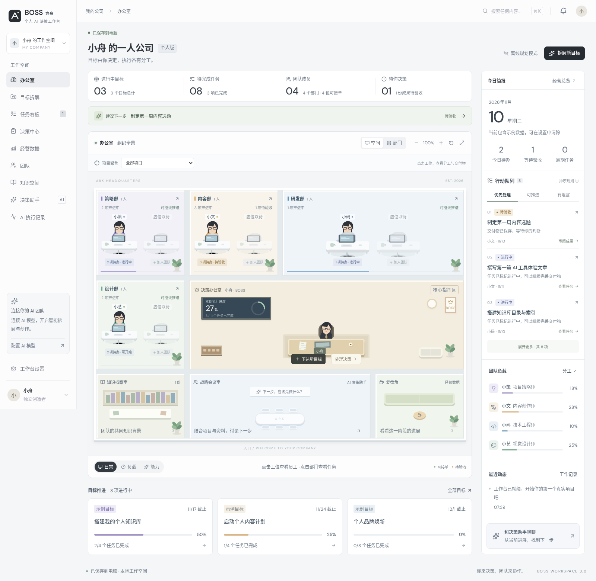

# BOSS 方舟 · OPC 工作台

**从目标到交付，组织一个人的 AI 团队。**

BOSS 方舟是面向一人公司（OPC · One Person Company）的个人 AI 工作台，为独立开发者、自由职业者与个人创业者提供以项目为中心的工作空间。将目标拆解、AI 员工分工、执行审查、工程交付与项目知识放在一起，让工作有明确的输入、可追踪的过程和可留存的成果。

你负责方向、关键决策与最终验收；方舟帮助你组织执行，把一次次交付沉淀为自己的知识和流程。

**个人自部署 · 本地优先 · 自带模型密钥 · 电脑与手机协同**

[快速开始](#快速开始) · [使用手册](docs/USER-GUIDE.md) · [更新记录](docs/CHANGELOG.md) · [交付路线图](docs/DELIVERY-ROADMAP.md)



> 截图使用内置示例数据。仓库不包含个人数据库、模型密钥或备份。当前版本 **3.3.1**，面向个人本机与可信局域网使用。

## 为一个人的公司而设计

一个人可以承担多个角色，但不必让目标、任务、资料和成果散落在不同对话里。

- **以项目组织工作**：先明确目标、交付物与验收标准，再安排任务、依赖和负责人。
- **以角色组织 AI**：按技能、职责和工作方式配置 AI 员工，保留人工调整分工的空间。
- **以成果判断进展**：查看实际交付物、源码、执行记录与检查结果，而不只看任务状态。
- **以积累减少重复**：让已完成成果成为项目知识，让有效流程成为下一次工作的起点。

方舟聚焦个人项目经营与执行，不以多人账号、租户管理或企业 ERP 为产品方向。手机连接的是你自己的同一份工作台。

## 核心能力

| 能力 | 你可以完成的工作 |
| --- | --- |
| **目标与分工** | 从目标生成任务计划，设置交付合同、验收清单和前置依赖，按员工能力匹配分工并手动调整。 |
| **AI 执行与审查** | 文档任务按依赖后台推进，生成成果、独立请求审查并有限返工；支持暂停、执行追踪和人工验收。 |
| **网站工程交付** | 生成 React + Express + SQLite 文件工程；在支持的 Linux 隔离环境中构建、运行和检查，导出源码、报告与部署说明。 |
| **项目知识 RAG** | 导入 TXT / Markdown，区分公共与项目资料，检索相关片段并保留来源；已完成成果可成为后续任务的参考。 |
| **成果与版本** | 集中查看交付物、审批和历史版本；保护工程稳定版与手动锁定版，支持基于历史源码继续迭代。 |
| **流程复用** | 将任务、依赖、角色和验收要求保存为流程模板，下次创建项目时重新排期，不复制旧成果与审批结论。 |
| **数据与手机协同** | SQLite 本地存储、业务快照与完整迁移备份；手机配对后查看和编辑同一份数据，冲突时明确提示。 |

## 从一个目标开始

```text
设定目标与验收标准
        ↓
拆解任务 · 确认角色与依赖
        ↓
文档执行 / 网站工程生成
        ↓
审查与检查 · 必要时返工
        ↓
人工验收 · 导出交付物
        ↓
项目复盘 · 知识沉淀 · 流程复用
```

适合把轻量网站、研究方案、内容策划与个人服务项目组织成可管理的工作过程。文档任务交付可编辑正文；网站任务进入独立的「工程交付」，提供实际文件，不把 Markdown 文档包当成可运行项目。

## 快速开始

### 1. 安装并启动

工作台需要 **Node.js 22.18+**，建议使用 **Node.js 24+**。Windows、macOS 与 Linux 均可运行基础工作台；自动工程验证另有 Linux 环境要求。

```bash
git clone https://github.com/4416n/ark-personal-workspace.git
cd ark-personal-workspace
npm ci
npm run build
npm start
```

在电脑浏览器打开 `http://127.0.0.1:5173`。`npm start` 同时启用局域网连接；仅本机使用可改为 `npm run start:local`。保持服务运行，关闭终端或电脑休眠会中断访问。

这是包含 Node.js 后端的应用，不能只部署到 GitHub Pages。

### 2. 连接自己的模型

在「工作台设置 → 连接 AI 模型」填写 **Base URL、模型名和 API Key**。支持兼容 Chat Completions 的接口，实际可用模型以你的服务商为准。

**一套模型配置供所有 AI 员工共用**：规划、生成、审查与工程任务通过角色指令和项目上下文区分，无需为每位员工单独配置 Key。没有 Key 时仍可管理项目与资料，离线规划使用规则模板，不模拟 AI 已经执行。

连接测试与实际执行会调用你配置的服务，费用由该服务商计收。用量可追踪，不设置按员工或项目累计的 Token 预算熔断；单次输出参数、超时、人工停止与有限重试仍然保留。

### 3. 创建你的第一个项目

1. 设置个人资料，按需清除示例项目并配置 AI 员工。
2. 在「目标拆解」写清目标，选择文档或完整网站工程，补充验收标准。
3. 检查计划和分工，确认执行范围后启动。
4. 查看成果与检查证据，完成必要修改和最终验收，再导出交付物。

### 4. 在手机上继续

电脑和手机连接同一可信 Wi-Fi，在「工作台设置 → 手机连接」扫描地址二维码，再输入电脑生成的一次性连接码。配对后共享项目与模型配置，Key 仍只在电脑本机管理。

当前手机访问是**局域网模式**，不是云同步或外出远程访问。不要将工作台端口直接映射到公网。详见 [手机连接方法](docs/USER-GUIDE.md#手机连接方法)。

## 本地优先，边界清晰

### 数据由你保管

- 业务数据和工程记录保存在本机 SQLite，模型 Key 保存在后端本地配置中，不返回前端，也不进入导出备份。
- 调用 AI 时，会将相关目标、任务、角色指令及检索命中的资料片段发送给你配置的模型服务；**本地存储不等于模型推理也在本地**。
- 普通 JSON 导出用于业务数据；更换电脑或迁移完整工作台，应使用设置中的完整备份，包含源码、执行记录与快照。
- 完整备份恢复需要本机预览和确认；不会恢复设备授权、覆盖模型 Key，或自动启动会产生模型费用的任务。

详细存储位置、备份限制与迁移注意事项见 [使用手册](docs/USER-GUIDE.md#数据与隐私) 和 [更新记录](docs/CHANGELOG.md)。

### 如实呈现交付状态

| 当前支持 | 需要了解的边界 |
| --- | --- |
| 固定技术栈的网站工程生成与检查 | 不是任意语言、任意规模的通用编程代理；复杂业务需要专门实现与验收。 |
| Linux 操作系统隔离下的真实构建与运行 | 环境不支持时只交付未验证源码，不降级到宿主机直接执行；Windows / macOS 暂不支持自动工程验证。 |
| 构建、接口、动态持久化和浏览器检查 | 检查通过不代表所有需求达标，也不代表独立安全审计或生产部署完成。 |
| 工程源码、运行截图和 Docker / Compose 配置 | 截图不是可交互站点；尚不提供部署中心，容器镜像构建和公开上线不在当前验证范围内。 |
| 项目范围的关键词 RAG | 目前采用 BM25 检索；PDF / OCR、向量与混合检索尚未实现。 |

分阶段工程执行、检查点恢复、逐条需求验收与安全交互预览见 [交付路线图](docs/DELIVERY-ROADMAP.md)。规划中的能力不作为当前版本承诺。

## 文档与反馈

| 文档 | 内容 |
| --- | --- |
| [使用手册](docs/USER-GUIDE.md) | 安装、模型连接、文档执行、工程验证、手机同步、数据保护与开发测试。 |
| [更新记录](docs/CHANGELOG.md) | 已发布版本的重要变更与兼容性说明。 |
| [交付路线图](docs/DELIVERY-ROADMAP.md) | 以个人使用为前提的交付可靠性计划、验收条件与未完成项。 |

欢迎通过仓库 Issues 反馈问题或讨论改进。请提供版本、操作系统、复现步骤及脱敏后的错误信息；不要上传 API Key、个人数据库或完整备份。

自动化回归覆盖业务逻辑、页面与隔离验证。测试使用模拟模型和样例工程，不等同于真实模型生成质量评测。开发与测试命令见 [开发与验证](docs/USER-GUIDE.md#开发与验证)。
